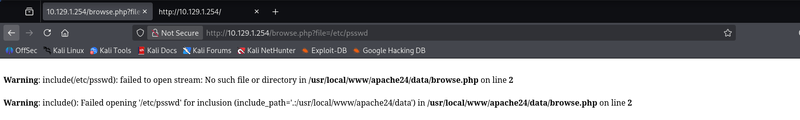

# Exploitation d'un log poisonning
Machine concerné HTB Poison

Rechercher les configurations permettant le log poisonning. 
On repére le **`allow_url_include`** à **`Off`**

ici dans une distribution FREEBSD le fichier de conf pour voir les fichiers de log  ou fichier error sont dans /usr/local/etc/apache24/httpd.conf # FreeBSD
la génération d'un erreur nous informe sur les chemins 

ceci nous permet donc d'adapter la recherche du fichier sur le chemin   /usr/local/www/apache24/httpd.conf

on peut donc consulter les fichiers qui nous permettrait de faire le Log poisonning
/var/log/http-error.log

/var/log/httpd-access.log

Modifier le user-agent pour injecter un paramètre php qui fera des commandes systèmes

 l'injection est réussit car on voit le résultat de la commande id

Test pour voir si une connection vers la machine cible

Reverse shell sur la machine pour en prendre le contrôle
Avoir un shell en /bin/sh plutôt que /bin/bash
